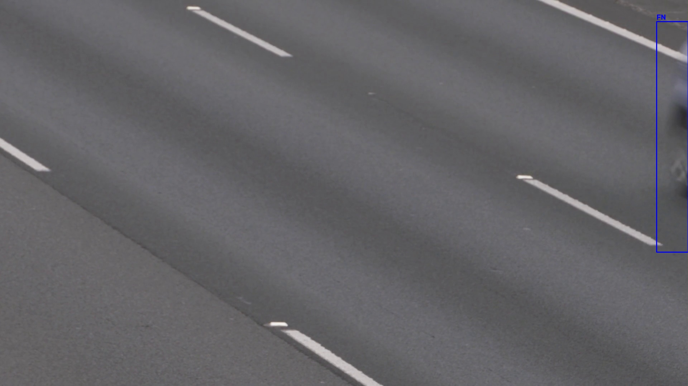
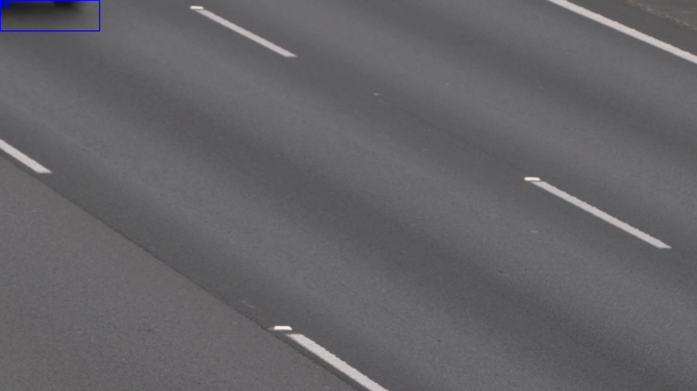
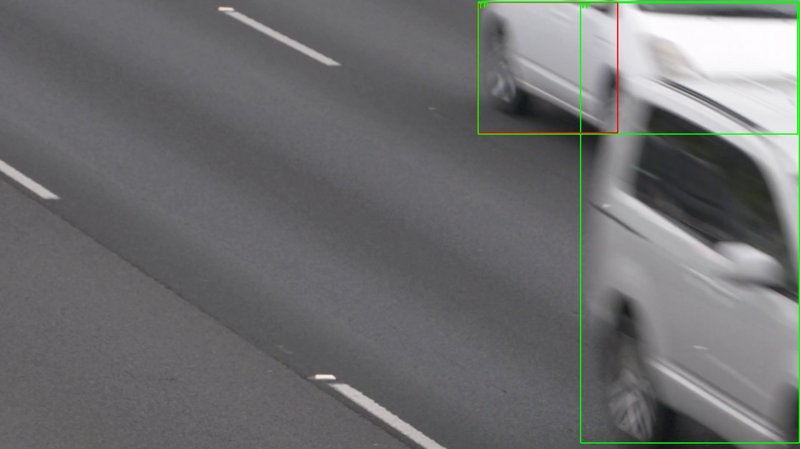

# Autonomous Driving Auto-Labeling Pipeline

**YOLO11n 기반 도로 영상 객체 탐지 및 자동 라벨링 파이프라인**

## 1. 프로젝트 소개

도로 영상에서 객체를 자동으로 탐지하고 YOLO 형식의 데이터셋을 생성하는 Python 기반 파이프라인입니다.

자율주행 데이터셋 구축 과정에서 반복되는 프레임 추출과 객체 라벨링 작업을 자동화하고, 사람이 직접 제작한 Ground Truth를 이용하여 자동 라벨의 품질을 평가하는 것을 목표로 개발했습니다.

## 2. 사용 기술

- Language: Python 3.12
- Computer Vision: OpenCV
- Object Detection: YOLO11n (Ultralytics)
- Data Analysis: pandas
- Evaluation: IoU, Precision, Recall, F1-score

## 3. 주요 기능

1. **영상 프레임 추출:** OpenCV를 활용한 일정 간격의 이미지 추출
2. **자동 객체 탐지:** 사전 학습된 YOLO11n 모델을 활용한 객체 탐지
3. **자동 라벨 생성:** 객체 클래스와 정규화된 Bounding Box 좌표를 YOLO 형식으로 저장
4. **클래스 필터링:** 자동차 클래스만 선택적으로 탐지하는 기능
5. **데이터셋 검증:** 라벨 파일의 형식 및 좌표 범위 검사
6. **모델 성능 평가:** Ground Truth와 예측 박스를 IoU 기반으로 비교
7. **오류 분석:** FP 및 FN 발생 이미지 자동 시각화

## 4. 실행 방법

Python 3.12 환경을 기준으로 개발했습니다.

프로젝트에 필요한 라이브러리 설치:

`python -m pip install -r requirements.txt`

프로젝트의 `data/videos/road.mp4` 위치에 분석할 영상을 준비합니다.

전체 클래스 자동 라벨링:

`python main.py`

자동차 클래스만 분석:

`python main.py --car-only --out pipeline_car`

모델 성능 평가:

`python evaluate_model.py`

평가 전에 `ground_truth/labels`에 해당 영상의 검수된 정답 라벨이 준비되어 있어야 합니다.

## 5. 실험 결과

고정형 CCTV 영상에서 추출한 이미지 18장을 대상으로 자동차 탐지 성능을 평가했습니다.

- Ground Truth: 자동차 17개
- 모델: YOLO11n
- IoU Threshold: 0.5

| Confidence | Precision | Recall | F1-score |
|---|---|---|---|
| 0.25 | 93.8% | 88.2% | 90.9% |
| 0.50 | 92.3% | 70.6% | 80.0% |
| 0.75 | 91.7% | 64.7% | 75.9% |

해당 데이터에서는 신뢰도 임계값 0.25에서 가장 높은 F1-score를 기록했습니다.

## 6. 오류 분석

Confidence Threshold 0.25 기준:

- TP: 15
- FP: 1
- FN: 2

주요 사례:

- `frame_000004`: 화면 경계의 부분 차량 미탐
- `frame_000007`: 일부만 노출된 차량 미탐
- `frame_000010`: 동일 차량 주변에 추가 예측 박스 발생

자동 생성된 라벨의 품질을 확인하기 위해 사람이 직접 제작한 Ground Truth와 비교하고, 오류가 발생한 프레임을 시각화했습니다.

### 오류 분석 시각화

**1. 화면 경계의 부분 차량 미탐**

**2. 화면 상단의 부분 차량 미탐**

**3. 추가 탐지 박스 발생**

## 7. 실험의 한계 및 향후 개선

본 실험은 단일 CCTV 영상에서 추출한 18장을 대상으로 진행했습니다. 따라서 측정된 성능을 다른 촬영 환경이나 실제 자율주행 시스템 전체에 일반화할 수 없습니다.

또한 Ground Truth는 수작업으로 작성했으므로 라벨링 품질의 영향을 받을 수 있습니다.

향후에는 이동형 카메라 영상 추가, 다양한 객체 클래스 평가, 데이터셋 규모 확장 및 후처리 실험을 진행할 계획입니다.

## 8. 프로젝트 문서

- `docs/experiment_log.md`: 실험 설정과 결과
- `docs/error_analysis.md`: 오류 사례 및 원인 분석
- `reports/`: 성능 평가와 통계 CSV

## 9. 참고 사항

자동 생성된 라벨은 검수가 완료된 정답이 아닌 Pseudo-label입니다.

본 프로젝트는 사전 학습된 YOLO11n 모델을 활용한 데이터 처리·평가 파이프라인 구현 프로젝트이며, 객체 탐지 모델 자체를 새롭게 학습시킨 프로젝트는 아닙니다.
